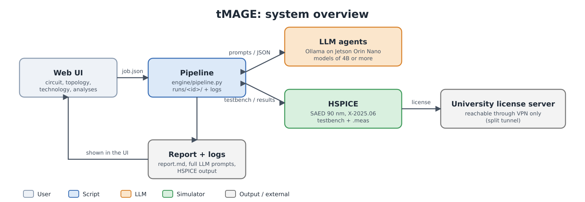
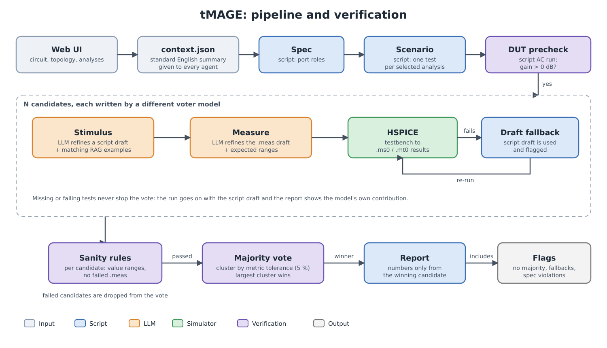

# tMAGE: testbench Multi-Agent Generation Engine

GTU ELM491 graduation project. Given an analog circuit netlist, a topology and a set of analyses, small local LLM agents write HSPICE testbenches. The system simulates them, **verifies the results by majority voting plus sanity rules** and writes a report. Sizing and optimisation are out of scope.

Students: Orhan Haluk Tascioglu, Nisa Bekci. Advisor: Prof. Dr. Engin Afacan.

## Status

Work in progress, **results are preliminary**. The model benchmark (9 models x 3 circuits x 3 runs x 3 voted candidates) is finished: [docs/23_Model_Benchmark_Report.md](docs/23_Model_Benchmark_Report.md). Next: mixed-model voting, see [ROADMAP.md](ROADMAP.md).

| | |
|---|---|
| Circuits with script drafts | DA (diff amp), FCO (folded-cascode OTA), TSO (two-stage op-amp) |
| Circuits without drafts yet | BGR (bandgap), LNA |
| Not supported yet | COMP, OSC (flat netlists, no `.subckt`; OSC needs harmonic balance) |
| Technology | SAED 90 nm, HSPICE X-2025.06-SP2 |
| LLM runtime | Ollama on a Jetson Orin Nano (8 GB), models of 4B parameters or more |
| UI | Local web UI, stdlib Python only (its texts are still Turkish; translation is planned) |

## How it works

```
job.json -> context.json -> spec -> scenario -> [DUT precheck]
         -> N candidates { stimulus -> measure -> HSPICE } -> verify (rules + vote) -> report
```

Design rules that came out of testing small models:

* Everything deterministic is done by **script** (spec, scenario, testbench and `.meas` drafts); the LLM only refines.
* The model gets a **verified draft** plus matching real examples from the kit (RAG) and a short English prompt with a list of known errors and fixes.
* Wrong outputs are caught by **sanity ranges** and by **voting across candidates**; a failing test falls back to the script draft and is flagged (the report shows the model's own contribution).
* Everything is English (prompts, context, logs, reports, documents) except the UI texts, code comments and `config/` labels, which are being translated.

## Plan at a glance

✅ done · 🔄 running · ❌ not done yet. Details and order: [ROADMAP.md](ROADMAP.md).

| | Stage |
|---|---|
| ✅ | Local web UI (circuit, topology, technology, analyses, LLM and voting settings) |
| ✅ | HSPICE with the university license through a split-tunnel VPN |
| ✅ | Netlist adaptation to SAED 90 nm |
| ✅ | Script-first pipeline: spec, scenario, testbench and `.meas` drafts, RAG, JSON schema, English prompts |
| ✅ | Majority voting with sanity rules, batch runner, full logging |
| ✅ | End-to-end runs on DA, FCO and TSO |
| ✅ | Model benchmark on the Jetson (9 models, 3 circuits, 3 runs each) |
| ✅ | Verilog-A toolchain works (smoke test) |
| ✅ | GitHub repository, versions as tags, automatic local and GitHub backup |
| ✅ | Failed-`.meas` parsing bug fixed, all scores recomputed |
| 🔄 | Mixed-model voting (command-r7b, qwen3:4b-instruct, deepseek-coder:6.7b) |
| ❌ | RAG over books and papers (modular RAG study) |
| ❌ | Ablation of the improvements (script-first, drafts, RAG, schema, prompts, language) |
| ❌ | BGR and LNA drafts; COMP and OSC through a `.subckt` wrapper |
| ❌ | Corners x temperature x supply (PVT) and Monte Carlo |
| ❌ | Verilog-A inside the pipeline |
| ❌ | Optional LLM explanation in the report (numbers only from the verify output) |
| ❌ | Per-agent model defaults in the UI, VPN on/off button |
| ❌ | SKY130 / ngspice fallback plan |
| ❌ | Final report and presentation |

## Architecture





Vector versions: [architecture.svg](docs/images/architecture.svg), [pipeline.svg](docs/images/pipeline.svg). They are generated by `scripts/make_figures.py` (render PNGs with `rsvg-convert -w 1500 docs/images/<name>.svg -o docs/images/<name>.png`).

## Repository layout

| Path | Content |
|---|---|
| `app/` | Web UI (`server.py`, `static/index.html`) |
| `config/` | topology/technology/analysis catalog, stage schemas, agent prompts, `prompt_versions/` |
| `engine/` | pipeline, context hand-off, RAG and script drafts, Ollama client, HSPICE runner, batch runner |
| `scripts/` | VPN service, model benchmark, mixed-model voting, ranking, findings scanner |
| `docs/` | Obsidian vault: design notes, change log, observed errors, prompts, HSPICE manual notes |

Included: the kit netlists and parameter files (`knowledge/inputs`, `knowledge/examples`) and the SkyWater device models (Apache-2.0), because the RAG step and the batch runner read them.

Not in the repository (git-ignored, see `.gitignore`): Synopsys tools, PDK and manual, the VPN helper, vendor process models (`130nm.txt`, `inductor.txt`, `mimcap.txt`; get them from the university kit), simulator output files, run outputs (`runs/`, `batch/`) and local config (`config/env.sh`, `config/jetson.env`).

## Quick start

```bash
cp config/env.sh.example config/env.sh      # tool paths and license server
cp config/jetson.env.example config/jetson.env
source config/env.sh
./run.sh                                    # UI at http://127.0.0.1:8765
python3 engine/batch.py --only DA --reps 3 --n 3 --voters qwen3:4b-instruct,qwen3:4b-instruct,qwen3:4b-instruct --agent qwen3:4b-instruct
```

Requires Python 3.9 (standard library only), HSPICE X-2025.06-SP2 with a reachable license (university VPN), the SAED 90 nm PDK and an Ollama server with the models you select.

## Setting up as a collaborator

1. `git clone git@github.com:Hymnelaus1/tMAGE.git` (you need to be invited to the private repository).
2. Copy `config/env.sh.example` to `config/env.sh` and `config/jetson.env.example` to `config/jetson.env`, then fill in your own paths, license server and Ollama address. These files stay local.
3. Put the files that are not shared (vendor process models, Synopsys PDK/tools) in place from the university kit.
4. Optional automatic backup: `scripts/install_backup.sh` (git post-commit hook plus a 2-hourly timer; local copy in `/data/tmage_backups`, push to `origin`).
5. Do not commit run outputs, credentials or local config. Check `git status` before every commit.

## Versions

Every version is tagged; `git log --oneline` and the GitHub tags/releases list them.

| Tag | What it is |
|---|---|
| `v0.1.0` | First version: UI, pipeline, logging, docs |
| `v0.2.0` | Improved mode: script-first spec/scenario, drafts, RAG, batch runner |
| `v0.3.0` | English prompts, HSPICE-manual rules, benchmark and findings tooling, prompt versions |
| `v0.3.1` | Pitfalls aggregated from the first benchmark logs (proposed, not yet active) |

Earlier prompt sets are kept as files in `config/prompt_versions/` (`v1_old`, `v2_manual`, `v3_pending_pitfalls.json`).

## Known issues

* Models of different families rarely agree on small circuits without script drafts; see the benchmark report.
* Sizes come from 130 nm kit netlists, so results validate the flow, not a real 90 nm design.
* `gpt-oss:20b` crashes Ollama on the 8 GB Jetson.

## Documentation

`docs/` also opens as an Obsidian vault (Obsidian > *Open folder as vault* > `docs/`).

Start with `docs/17_Handoff_for_new_chat.md` (project state, access, lessons) and `docs/18_Change_Log_Benchmark.md` (chronological change log).

## Privacy

`.ovpn` files, `config/env.sh`, `config/jetson.env`, run outputs and logs are git-ignored. License and site IDs must not be committed. Keep this repository **private**.
